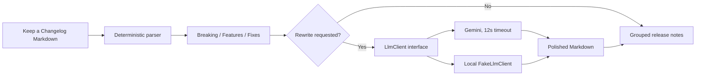

# Changelog AI

Turn a Keep a Changelog Markdown file into focused release notes, grouped into
breaking changes, features, and fixes. An optional rewrite step polishes those
already-parsed groups into customer-ready Markdown.

## How it works

The parser is deterministic: it reads Markdown headings and list items under
`Breaking`, `Added`, `Changed`, and `Fixed`. Added and Changed items are grouped
as Features. The optional language model only receives that structured result,
so it cannot replace or skip the parsing step. If rewriting is disabled, the
application has no external AI dependency. If Gemini is unavailable, the
parsed release notes still render normally.



## Run locally

Requirements: PHP 8.3+, Composer, Node.js 22+, and npm.

```bash
composer setup
```

The setup command creates `.env` from `.env.example` when needed, generates an
application key, migrates the local SQLite database, seeds two fictional Harbor
Desk changelogs, and builds the Vue frontend. Start the app and Vite dev server
with:

```bash
composer dev
```

Open [http://localhost:8000](http://localhost:8000). No account or demo
credentials are required; the app is public and guest submissions are stored
locally. The seed examples include Harbor Desk 2.4.0 with a breaking API field
change and Harbor Desk 2.3.2 with feature and fix notes.

### Run without an API key

Leave `GEMINI_API_KEY` empty in `.env`. The application binds
`FakeLlmClient`, which formats the parsed groups locally so the complete rewrite
flow can be demonstrated without network access or credentials. Uncheck
“Polish the grouped notes” to see parsing-only behavior.

To enable a real rewrite, set `GEMINI_API_KEY` (and optionally `GEMINI_MODEL`,
which defaults to `gemini-2.5-flash`) in `.env`. Gemini calls have a 12-second
request timeout. Provider failures are logged and shown as a non-blocking
message; the deterministic groups remain available.

## Tests and AI behavior

```bash
composer test
```

Pest tests verify that the parser extracts Breaking, Added, Changed, and Fixed
items; the fake client is the default binding with no key; an unauthenticated
POST returns the grouped results successfully; the rewrite receives the parsed
JSON groups instead of the original raw dump; and a rewrite failure does not
hide the deterministic output.

## Stack

- Laravel 13 / PHP 8.3+
- Vue 3, Inertia, and Tailwind CSS
- SQLite for local persistence
- Gemini API through `App\Services\Llm\LlmClient` (optional)
